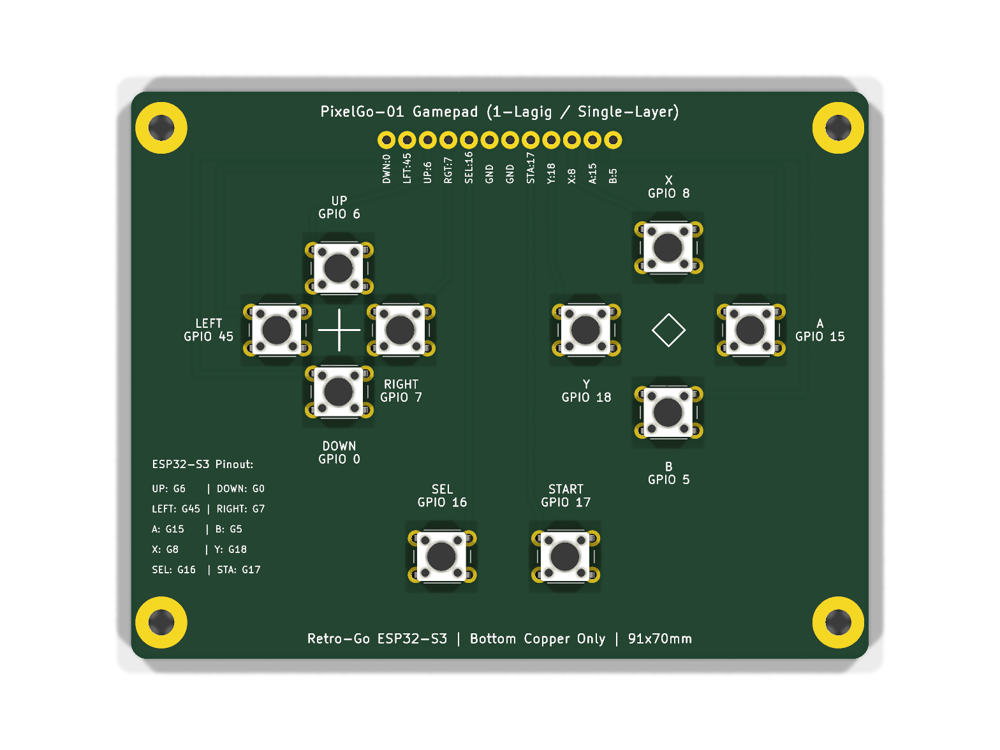
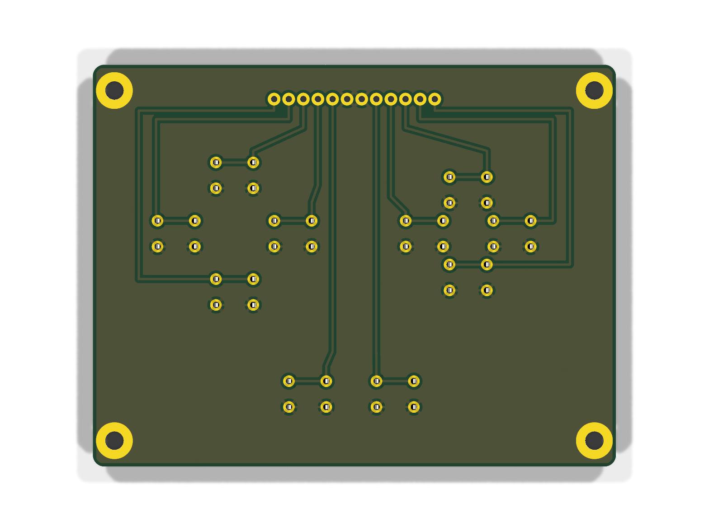

# PixelGo-01 Gamepad PCB (KiCad 10)

Einlagiges Gamepad-Platinenlayout (Single-Sided / `B.Cu` only) für den **PixelGo-01** Handheld (ESP32-S3 DevKitC-1 N16R8).

> 💡 **Hinweis zum Hardware-Ansatz (DIY-Hilfslösung vs. professionelle Leiterplatte):**  
> Die hier bereitgestellte einlagige Gamepad-Platine mit Einzelader-Verdrahtung (Klingeldraht) zu den einzelnen Modulen ist eine **pragmatische Hilfs- und Prototyplösung**, um das Projekt mit einfachen Maker-Mitteln zu Hause (Tonertransfer mit dem Bügeleisen, Ätzbad, Standard-Breakout-Module) schnell und kostengünstig zu realisieren.  
> Für eine finale Serienreife oder maximale Kompaktheit sind **professionell gefertigte Multi-Layer-Leiterplatten**, die sämtliche Komponenten (ESP32-S3 SoC, Laderegler, Step-Up-Wandler, I2S-DAC, MicroSD-Slot, Display-FPC und Taster) monolithisch auf einer einzigen Platine vereinen, natürlich **eindeutig im Vorteil** (flachere Bauhöhe, perfekte EMV/Signalintegrität und kein manueller Verdrahtungsaufwand).

---

## 3D-Vorschau

| Oberseite (Bestückungsseite) | Unterseite (Lötseite B.Cu) |
| :---: | :---: |
|  |  |

---

## Technische Daten

* **Abmessungen:** $91.0 \times 70.0\text{ mm}$ (Ecken gerundet $R = 2.0\text{ mm}$)
* **Kupferlagen:** 1 Lage (`B.Cu` Unterseite) – 0 Kupfer auf `F.Cu`, keine Durchkontaktierungen/Vias, keine Drahtbrücken
* **Befestigung:** 4x M3-Bohrungen ($\varnothing 3.2\text{ mm}$) im Raster $83.5 \times 61.0\text{ mm}$
* **Bedienelemente:** 10x Standard-Mikrotaster 6x6 mm THT (`SW_PUSH_6mm`)
* **Anschluss:** 12 durchkontaktierte Lötpads `W1` ($\varnothing 1.1\text{ mm}$ Bohrung, $\varnothing 2.2\text{ mm}$ Pad, 2.54 mm Raster)
* **Design Rules (DRC):** 0 Fehler, 0 Warnungen, 0 unverbundene Netze

---

## Pinbelegung Drahtanschluss (`W1`)

| Pad | Signal | ESP32-S3 | Funktion |
| :---: | :--- | :---: | :--- |
| **1** | `BTN_DOWN` | **GPIO 0** | D-Pad Unten |
| **2** | `BTN_LEFT` | **GPIO 45** | D-Pad Links |
| **3** | `BTN_UP` | **GPIO 6** | D-Pad Oben |
| **4** | `BTN_RIGHT` | **GPIO 7** | D-Pad Rechts |
| **5** | `BTN_SELECT` | **GPIO 16** | Select |
| **6** | `GND` | **GND** | Masse 1 |
| **7** | `GND` | **GND** | Masse 2 |
| **8** | `BTN_START` | **GPIO 17** | Start |
| **9** | `BTN_Y` | **GPIO 18** | Action Y / Menu |
| **10** | `BTN_X` | **GPIO 8** | Action X / Option |
| **11** | `BTN_A` | **GPIO 15** | Action A |
| **12** | `BTN_B` | **GPIO 5** | Action B |

---

## Tonertransfer-Druckvorlagen (Bügelmethode)

* **[pixelgo_gamepad_tonertransfer_B_Cu.pdf](pixelgo_gamepad_tonertransfer_B_Cu.pdf)** *(Standard für Tonertransfer / Bügeleisen)*
  * Maßstab 1:1 (DIN A4), tiefschwarz, mit 50.0 mm Prüfbalken, Schnittmarken und mikroskopischen Zentrierkörnerpunkten für die Bohrungen.
* **[pixelgo_gamepad_tonertransfer_B_Cu_mirrored.pdf](pixelgo_gamepad_tonertransfer_B_Cu_mirrored.pdf)** *(Gespiegelt für Fotopositiv-Belichtung)*
* **[pixelgo_gamepad_tonertransfer_B_Cu.svg](pixelgo_gamepad_tonertransfer_B_Cu.svg)** *(Vektorgrafik)*

---

## Dateien im Ordner

* `pixelgo_gamepad.kicad_pcb`: KiCad 10 Platinenlayout
* `pixelgo_gamepad.kicad_sch`: KiCad 10 Schaltplan
* `pixelgo_gamepad.kicad_pro`: KiCad 10 Projektdatei
* `build_pixelgo_pcb.py`: Python-Skript zur automatisierten Neugenerierung
* `gerbers/`: Vollständiger Fertigungssatz (Gerber RS-274X & Excellon-Bohrdaten)
